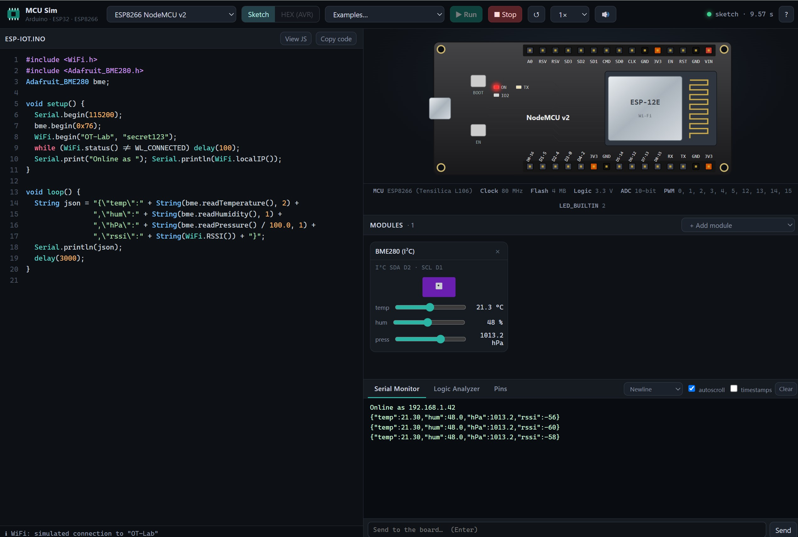

# Arduino & ESP32 Simulator

A browser-based simulator for Arduino, ESP32 and ESP8266 boards. Write a sketch, wire up modules and press **Run**. You can also load a compiled `.hex` file and run it on an emulated ATmega328P.

It's a single self-contained HTML file of about 225 KB. There's nothing to install, it needs no server or build step and it makes no network requests, so it works offline.

**▶ Live demo:** https://jurgenkobierczynski.com/MCU_Simulator/Arduino_ESP32_Simulator.html

---

## Features

- **Two simulation engines**
  - **Sketch mode (all boards):** your Arduino C/C++ is translated to JavaScript and run against an electrical model of the board. C integer semantics are kept: 16-bit `int` on AVR and 32-bit on ESP32/Uno R4, with overflow wrap-around and truncating integer division. *View JS* shows the translated code.
  - **HEX mode (ATmega328P boards):** your compiled firmware runs instruction by instruction on an emulated ATmega328P at 16 MHz, with timers, USART, ADC, GPIO and interrupts. Any C++ and any AVR library will run.
- **10 boards** drawn with their real header layout, pin numbering, PWM pins, interrupt pins, ADC resolution and logic voltage
- **37 modules**, wired to pins with a dropdown on each card
- **51 example sketches**, each loaded with its modules already wired
- **Serial Monitor** with send, line-ending choice, timestamps and autoscroll
- **Logic Analyzer** that traces every pin the sketch touches, including PWM duty cycles
- **Pins table** with live mode, level, PWM duty, tone frequency, servo angle and analog voltage
- **Buzzer sound** through Web Audio
- **Simulation speed** from 0.25× to 5×
- **Autosave:** your code and wiring are kept in the browser per board

## Supported boards

| Board | MCU | Logic | ADC | Sketch mode | HEX mode |
|---|---|---|---|:-:|:-:|
| Arduino Uno R3 | ATmega328P | 5 V | 10-bit | ✓ | ✓ |
| Arduino Nano | ATmega328P | 5 V | 10-bit | ✓ | ✓ |
| Arduino Pro Mini 5V | ATmega328P | 5 V | 10-bit | ✓ | ✓ |
| Arduino Leonardo | ATmega32U4 | 5 V | 10-bit | ✓ | |
| Arduino Mega 2560 | ATmega2560 | 5 V | 10-bit | ✓ | |
| Arduino Uno R4 (Minima / WiFi) | Renesas RA4M1 | 5 V | 10–14-bit | ✓ | |
| ESP32 DevKit V1 (WROOM-32) | ESP32 | 3.3 V | 12-bit | ✓ | |
| ESP32-S3 DevKitC-1 | ESP32-S3 | 3.3 V | 12-bit | ✓ | |
| ESP32-C3 SuperMini | ESP32-C3 | 3.3 V | 12-bit | ✓ | |
| ESP8266 NodeMCU v2 | ESP8266 | 3.3 V | 10-bit | ✓ | |

## Modules

| Category | Modules |
|---|---|
| Output | LED, RGB LED (common anode/cathode), WS2812 NeoPixel ring/strip, buzzer (passive/active), 74HC595 shift register + 8 LEDs |
| Display | 7-segment digit, LCD 16×2 (parallel), LCD I²C 16×2 / 20×4, OLED SSD1306 128×64, TM1637 4-digit, MAX7219 8×8 matrix (1 or 4 panels) |
| Actuator | Servo (SG90), stepper 28BYJ-48 + ULN2003, stepper + A4988 (STEP/DIR), DC motor + L298N, relay module |
| Input | Push button, slide switch, potentiometer, joystick (KY-023), rotary encoder (KY-040), 4×4 keypad, TTP223 touch sensor |
| Sensor | LDR, PIR (HC-SR501), HC-SR04 ultrasonic, DHT11/DHT22, DS18B20, BME280, NTC thermistor, soil moisture, MQ-2 gas, HX711 load cell, MPU6050, DS3231 RTC |
| Communication | IR receiver with a 21-key NEC remote, RC522 RFID reader with three tags |

### Modules in HEX mode

In HEX mode the modules are decoded electrically from the pin signals of the emulated CPU, so they work with real compiled libraries:

- LED, RGB LED, 7-segment, buzzer (measured frequency), servo (measured pulse width), relay
- 28BYJ-48 (coil sequence), A4988 (STEP/DIR pulses), L298N (PWM duty and direction)
- 74HC595 (shift and latch clocks), MAX7219 (bit-banged SPI, e.g. LedControl)
- Parallel LCD (HD44780 4-bit bus)
- 4×4 keypad (row/column scanning), rotary encoder (quadrature), buttons, switches, joystick, touch, PIR
- HC-SR04 (real echo pulse), plus every analog sensor through the ADC

These modules need a protocol-level device model and work in sketch mode only: NeoPixel, DHT, DS18B20, BME280, MPU6050, DS3231, HX711, TM1637, IR receiver, RC522 and the I²C displays.

## Sketch mode: what's supported

**Arduino core:** `pinMode`, `digitalRead/Write`, `analogRead/Write`, `analogReadResolution`, `millis`, `micros`, `delay`, `delayMicroseconds`, `tone/noTone`, `pulseIn`, `shiftOut/shiftIn`, `attachInterrupt` (CHANGE / RISING / FALLING), `map`, `constrain`, `random`, the bit macros, the `String` class, `sprintf`, `dtostrf`, and `Serial` (`print`, `println`, `printf`, `read`, `available`, `readStringUntil`, `parseInt` …).

**Libraries:** Servo / ESP32Servo, LiquidCrystal, LiquidCrystal_I2C, Adafruit_SSD1306 + Adafruit_GFX, Adafruit_NeoPixel, DHT, OneWire + DallasTemperature, Adafruit_BME280 / BMP280, Adafruit_MPU6050, Stepper, Keypad, TM1637Display, LedControl, IRremote (`IrReceiver` and the classic `IRrecv` API), MFRC522, HX711, RTClib (DS3231 / DS1307, `DateTime`). `Wire` and `SPI` are stubs.

**ESP32 / ESP8266:** `ledcAttach` / `ledcSetup` / `ledcWrite`, `dacWrite`, `Serial.printf`, `IRAM_ATTR`, `ESP.*`, and a simulated `WiFi` that connects after about 1.5 s and gets IP 192.168.1.42.

**Not supported in sketch mode:** user-defined classes/structs, templates, pointers and references, FreeRTOS tasks and real networking. For full C++ on AVR, compile the sketch and use HEX mode.

## Using HEX mode

1. Select an **Uno**, **Nano** or **Pro Mini** and switch to **HEX (AVR)**.
2. Get a `.hex` file:
   - **Arduino IDE:** *Sketch → Export Compiled Binary*, then use `yoursketch.ino.hex` (not the `with_bootloader` one).
   - **arduino-cli:** `arduino-cli compile -b arduino:avr:uno --output-dir out yoursketch`
3. Drop the file on the panel, or click *Choose file…*, then press **Run**.

A tiny hand-assembled `blink.hex` is built in for a quick test.

## Running locally

Download `Arduino_ESP32_Simulator.html` and open it in a modern browser (Chrome, Edge, Firefox or Safari). That's all.

## Tips

- **Ctrl/⌘ + Enter** restarts the sketch.
- Buttons are wired to GND by default, so use `INPUT_PULLUP`. Keep the mouse pressed to hold a button.
- A floating input reads LOW and `analogRead` on an unconnected pin returns noise, as on real hardware.
- Turn the rotary encoder with the arrow buttons or by scrolling over the knob.

## Credits and third-party licences

- **[avr8js](https://github.com/wokwi/avr8js)** by Uri Shaked: AVR CPU and peripheral emulation, MIT License.
- **5×7 font** from **[Adafruit-GFX-Library](https://github.com/adafruit/Adafruit-GFX-Library)** (`glcdfont.c`): Copyright © 2012 Adafruit Industries, BSD License.

Both are bundled inside the HTML file.

## Licence

MIT. See [LICENSE](LICENSE).
